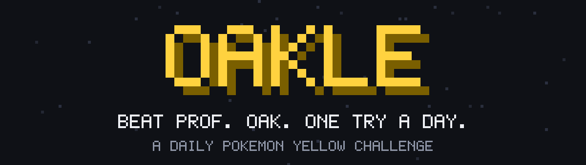

<p align="center">
  
</p>

<h3 align="center">A daily Pokémon Yellow challenge.</h3>

<p align="center">
  Everyone gets the same random team.<br>
  Professor Oak is waiting.<br>
  You get one try.
</p>

---

## What is Oakle?

Think Wordle, but you battle. Every day a brand new team of five random Pokémon lands in your hands, the same five for every player in the world, and you have a single attempt to beat Professor Oak's team with it.

It is the real Pokémon Yellow, running right in your browser with its original sound. The battle plays out exactly like the game you remember, only here the stakes are one try, a leaderboard and bragging rights.

## A day in Oakle

1. **A new team arrives at midnight.** Five random Pokémon, each with four random moves, plus a fresh set of dice that is the same for everybody.
2. **Plan your order.** Open your team, arrange it the way you like, and decide how you want to open.
3. **Battle Professor Oak.** His team is his unused Gen 1 line-up, all at level 100, and you get exactly one try. No rematches.
4. **See how you did.** The fewest turns tops the day's leaderboard. Win on consecutive days to build a streak.

Some days are brutal on purpose.

## Features

|                               |                                                                              |
| ----------------------------- | ---------------------------------------------------------------------------- |
| **One try a day**             | No retries, no do-overs. Every battle counts.                                |
| **Same team for everyone**    | Same Pokémon, same moves, same dice. Skill decides, not luck of the draw.    |
| **The real game**             | Real Pokémon Yellow battles with the original music and sound effects.       |
| **Leaderboards**              | Today's fastest wins, all-time wins, and the longest win streaks.            |
| **Archive**                   | Missed a day? Play it later. It still counts towards your wins.              |
| **Play anywhere**             | On-screen controls for your phone, keyboard for your laptop.                 |
| **Take your record with you** | Link your phone and laptop with a short one-time code. No account, no email. |
| **Share your result**         | Post a spoiler-free result grid, just like the games that inspired it.       |

## Share your result

```
Oakle #12 ✅ 9 turns
🟩🟩🟩🟥🟥
```

Each square is one of your five Pokémon. Green means it was still standing at the end.

## Fair play

Everyone fights the same battle under the same rules, and winning battles can be checked by replaying them move for move. Names are kept friendly too, so the leaderboard stays a nice place to be.

## A fan project

Oakle is an unofficial fan project. It is not affiliated with, endorsed by or sponsored by Nintendo, Game Freak or The Pokémon Company. Pokémon and Pokémon character names are trademarks of their respective owners. This repository contains no game files. See [NOTICE](NOTICE).

## License

[MIT](LICENSE). Third-party components keep their own licenses, listed in [NOTICE](NOTICE).
